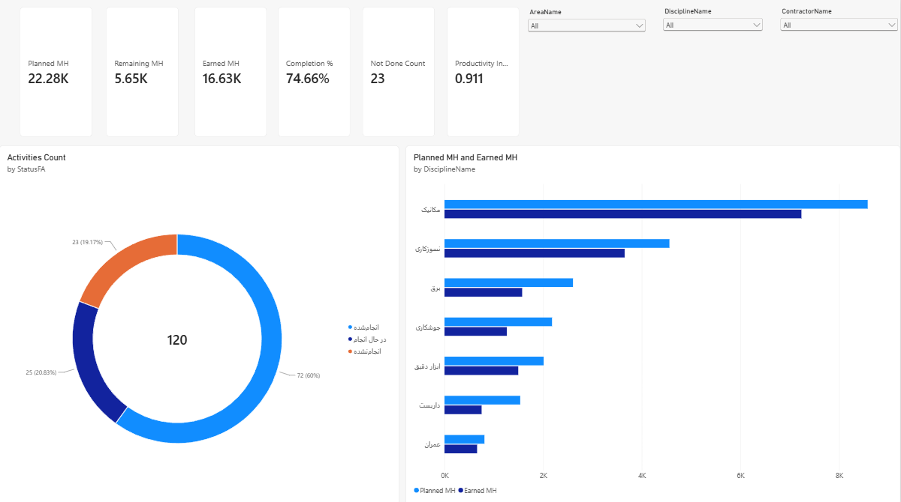
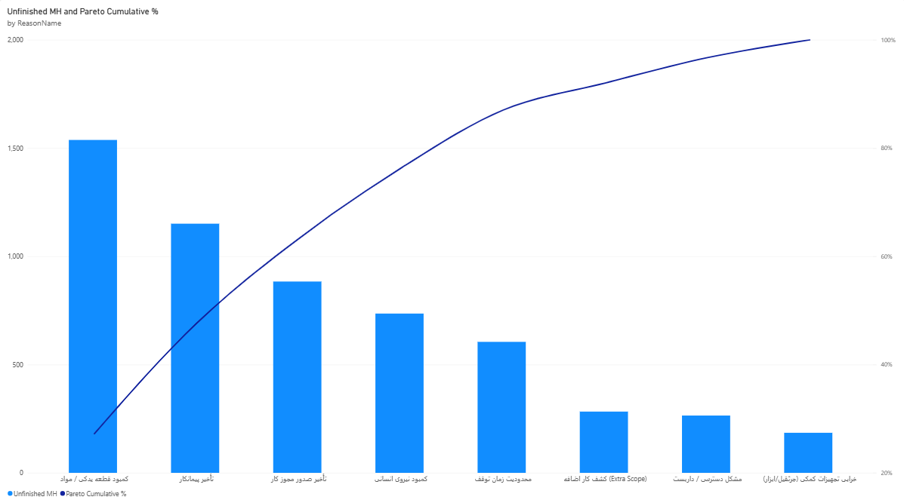
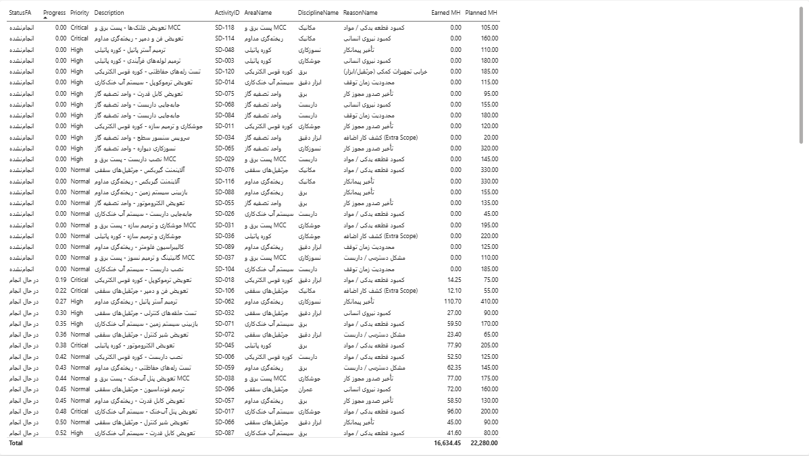
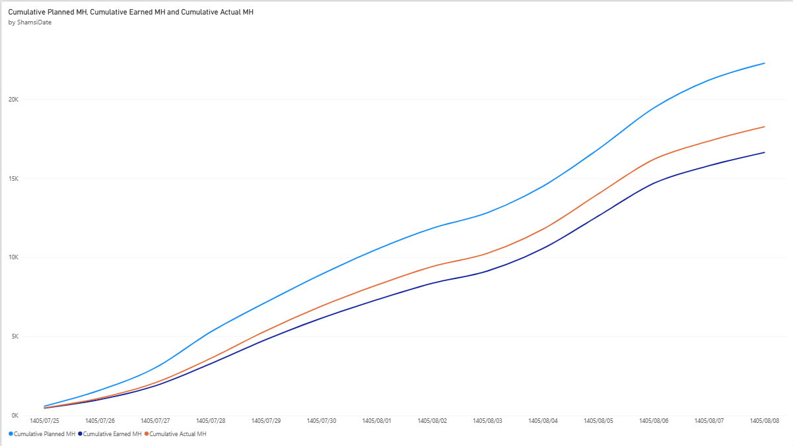

# Steel Plant Shutdown Repair Dashboard (Power BI)

A management dashboard for tracking **shutdown (turnaround) repair work** in a steel plant. It shows
planned vs. earned vs. actual **man-hours**, how much work is **not done**, and **why** (Pareto analysis of
delay reasons), plus an S-curve of progress over time with a Jalali (Persian) calendar.

> **All data in this repository is fictional.** It was generated by a script for development and demo purposes.

## Screenshots






## Dashboard pages

| # | Page | Content |
|---|---|---|
| 1 | Executive summary | KPI cards (planned / earned / remaining man-hours, completion %, not-done activities, productivity index), activity status donut, planned vs. earned by discipline, slicers for area / discipline / contractor |
| 2 | Reasons for non-completion | Pareto chart of unfinished man-hours by reason with cumulative % |
| 3 | Activity details | Activity-level table sorted by progress, with status, discipline, area and reason |
| 4 | Trend | S-curve of cumulative planned vs. earned vs. actual man-hours by day (Jalali dates) |

The DAX file also contains resource-utilization measures (available man-hours, utilization %, idle MH) and SPI;
these are defined in the model but are not yet visualized.

## Key figures (sample data)

| Measure | Value |
|---|---|
| Planned man-hours | 22,280 |
| Earned man-hours | 16,634.45 |
| Actual man-hours | 18,267.63 |
| Completion % (earned / planned) | 74.66% |
| Productivity index (earned / actual) | 0.911 |
| Activities (done / in progress / not done) | 72 / 25 / 23 of 120 |

Expected values for validating the report are listed in [`docs/04-validation.md`](docs/04-validation.md).

## What's inside

| Path | Content |
|---|---|
| `Steel-Shutdown-Dashboard.pbix` | The Power BI report |
| `data/ShutdownRepair_SampleData.xlsx` | Fictional dataset: 120 activities, daily progress, resources, dimension tables, Jalali date table |
| `scripts/generate_sample_data.py` | Reproducible generator for the dataset (seed = 42) |
| `powerquery/*.pq` | Power Query (M) scripts, one per table, driven by a `FilePath` parameter |
| `dax/measures.dax` | All 29 DAX measures (completion %, earned MH, Pareto, S-curve, utilization, SPI, ...) |
| `theme/steel-theme.json` | Optional Power BI theme (Tahoma font, color palette) |
| `docs/` | Data model, dashboard design, build guide and validation numbers (written in Persian) |

## Data model

Star schema with three fact tables and five dimensions:

- **Facts:** `Fact_Activities`, `Fact_Daily`, `Fact_Resources`
- **Dimensions:** `Dim_Area`, `Dim_Discipline`, `Dim_Contractor`, `Dim_Reason`, `Dim_Date` (Gregorian + Jalali)

Earned man-hours are defined as *planned man-hours x progress %*. Details are in
[`docs/01-data-model.md`](docs/01-data-model.md).

## Open the report

1. Open `Steel-Shutdown-Dashboard.pbix` in **Power BI Desktop** (Windows).
2. If Power BI cannot find the data: `Home -> Transform data -> FilePath` and set the value to the full path of
   `data/ShutdownRepair_SampleData.xlsx` on your machine, then `Close & Apply`.

## Rebuild from scratch

```bash
pip install -r requirements.txt
python scripts/generate_sample_data.py      # regenerates the Excel file and docs/04-validation.md
```

Then follow [`docs/03-build-guide.md`](docs/03-build-guide.md): paste the Power Query scripts, create the
relationships, add the DAX measures, and compare the cards with [`docs/04-validation.md`](docs/04-validation.md).

## Tech

Power BI Desktop, Power Query (M), DAX, Python (`openpyxl`) for data generation.

## Git notes

- `.pbi/cache.abf` and `localSettings.json` are git-ignored.
- For readable diffs, you can save the report in **Power BI Project (`.pbip`)** format instead of `.pbix`.

## Author

Ali Reza Rezvani - https://www.linkedin.com/in/ali-reza-rezvani-65b1632a6

## License

All rights reserved. This repository is published for viewing and portfolio purposes only; see [LICENSE](LICENSE).
Please contact the author for any reuse.
